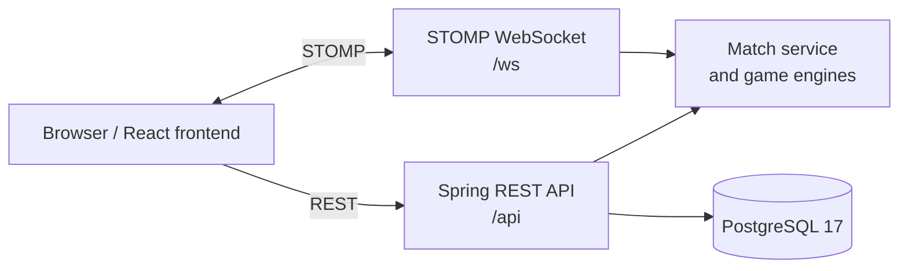

# Arcade

[](https://github.com/GBO-Inc/arcade/actions/workflows/ci.yml)

Real-time two-player board games in the browser: tic-tac-toe, Connect Four and checkers, with a quiz duel as an optional extra.

Built by the GBO-Inc team (Game Boards Online): Zoltán, István and Ozul.

## Tech stack

- Frontend: React 19, strict TypeScript, Vite 7, Tailwind CSS 4
- Backend: Java 21, Spring Boot 3.5, REST and STOMP over WebSocket
- Database: PostgreSQL 17 with Flyway migrations
- Tests: JUnit 5, Mockito, AssertJ, Testcontainers, Vitest, React Testing Library
- Delivery: Docker Compose locally, Gradle 9.8.2, GitHub Actions for CI

## Project structure

- `backend/` - Spring Boot application, Gradle build and integration tests
- `frontend/` - React 19, TypeScript and Vite application
- `docs/` - architecture, ADRs, retrospectives and wireframes
- `.github/` - CI workflow and pull request template

## Architecture



See [Architecture overview](docs/architecture.md) for components and the move data flow.

## Prerequisites

- Node.js 22 and npm
- Java 21
- Docker with Docker Compose
- Git

Docker must be running for integration tests and the Docker Compose setup.

## Run locally

### Docker Compose

Docker runs the complete stack. Create `.env` from the checked-in example:

```sh
cp .env.example .env
```

On Windows PowerShell:

```powershell
Copy-Item .env.example .env
```

Keep `.env` local and set `JWT_SECRET` to a string of at least 32 characters before starting the stack:

```dotenv
POSTGRES_DB=arcade
POSTGRES_USER=arcade
POSTGRES_PASSWORD=change-me
JWT_SECRET=local-development-only-jwt-secret-change-me
```

Then start the complete stack:

```sh
docker compose up --build
```

| Service | URL / port |
|---|---|
| Frontend | http://localhost:5173 |
| Backend | http://localhost:8080 |
| PostgreSQL | localhost:5432 (database, user and password from `.env`) |

The frontend dev server reloads automatically when a file in `frontend/` changes.

```sh
docker compose down       # stop; preserve database data
docker compose down -v    # stop and delete the database volume
```

Run `docker compose up --build` again after changing a Dockerfile. After `frontend/package.json` changes (for example after pulling new dependencies), run `docker compose up --build -V`: the `-V` flag recreates the container's `node_modules` volume, which otherwise keeps the old packages and the dev server fails with "Cannot find package".

If `docker compose up` stops with "required variable ... is missing a value", copy the missing lines from `.env.example` to `.env` (for example `JWT_SECRET`).

### Manual frontend

The Vite dev server listens on port 5173 and proxies `/api` and `/ws` to the backend, so the browser only talks to port 5173 and no CORS setup is needed. The proxy target defaults to `http://localhost:8080`; Docker Compose sets `API_PROXY_TARGET=http://backend:8080`. Leave `VITE_API_BASE_URL` unset for local development; it is only needed when the frontend is served without the dev server.

```sh
cd frontend
npm ci
npm run dev
```

If the backend runs somewhere else, set `API_PROXY_TARGET` before `npm run dev` (for example `export API_PROXY_TARGET=http://localhost:9090` or `$env:API_PROXY_TARGET="http://localhost:9090"`).

### Manual backend

The `.env` file must exist before starting PostgreSQL with Docker Compose. Copy `.env.example` to `.env` and set `JWT_SECRET` to at least 32 characters first.

Start PostgreSQL first:

```sh
docker compose up -d db
```

Set the database values and JWT secret in the shell.

macOS/Linux:

```sh
export POSTGRES_DB=arcade
export POSTGRES_USER=arcade
export POSTGRES_PASSWORD=change-me
export JWT_SECRET='your-local-secret-with-at-least-32-characters'
cd backend
./gradlew bootRun
```

Windows PowerShell:

```powershell
$env:POSTGRES_DB="arcade"
$env:POSTGRES_USER="arcade"
$env:POSTGRES_PASSWORD="change-me"
$env:JWT_SECRET="your-local-secret-with-at-least-32-characters"
cd backend
.\gradlew.bat bootRun
```

Optional shell variable: `WS_ALLOWED_ORIGINS=http://localhost:5173` or `$env:WS_ALLOWED_ORIGINS="http://localhost:5173"`. It defaults to `http://localhost:5173`.

## Tests and checks

Run frontend checks in `frontend/`:

```sh
npm ci
npm run lint
npm run typecheck
npm test
npm run test:coverage
npm run build
```

Run backend checks in `backend/`:

```sh
./gradlew test
./gradlew integrationTest
./gradlew build
./gradlew spotlessApply
```

On Windows, replace `./gradlew` with `.\gradlew.bat`.

`integrationTest` uses Docker-backed Testcontainers, so Docker must be running.

## Contributing

Read [CONTRIBUTING.md](CONTRIBUTING.md) before opening a pull request. AI-assisted use and the required human review process are documented in [docs/ai-usage.md](docs/ai-usage.md).
