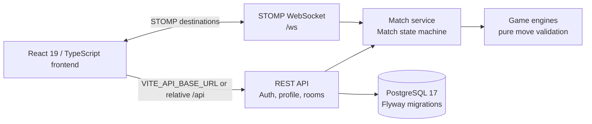
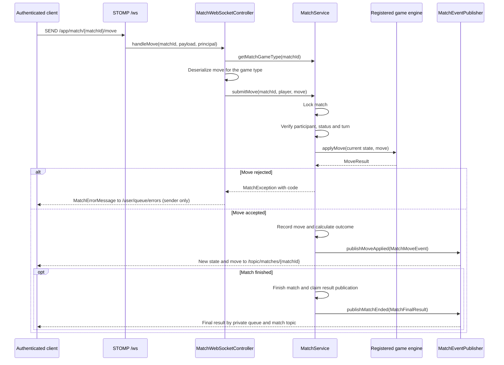

# Architecture

Arcade is a monorepo with a React frontend and a Spring Boot backend.

## Components

- The React frontend calls REST endpoints under `/api` for registration, login, the current user, rooms and profiles.
- Spring Security authenticates REST requests and STOMP channels. STOMP connections use `/ws`; clients send application messages below `/app`, subscribe to `/topic/**`, and receive private user messages below `/user/queue/**`.
- The lobby exposes room creation, listing and joining through `RoomController`.
- Successful room creation, joining, and leaving publish a room-list invalidation to
  `/topic/rooms`; clients refetch the open-room list through REST.
- `MatchService` owns match lifecycle and serialized state transitions. `MatchStateMachine` tracks waiting, in-progress, finished and abandoned states.
- Game engines implement the shared engine contract and receive state and moves as immutable Java records. Engines validate and apply moves without database, clock or network access.
- PostgreSQL stores Flyway-managed application data. Match state, disconnect handling and match-result publication are managed by the backend match components.

## One-move data flow

Clients send a move to `/app/match/{matchId}/move`. The message shapes and error codes are in [realtime-contract.md](realtime-contract.md).

The server is authoritative. A move is accepted only for an existing participant in an in-progress match whose turn it is. The engine receives the locked match state, rejects illegal moves and returns the next state. A rejected move leaves the state unchanged. Terminal outcomes are published once and the active match is removed from memory.
