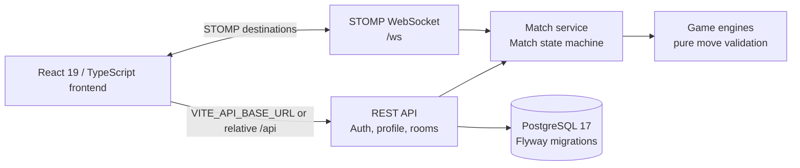

# Architecture

Arcade is a monorepo with a React frontend and a Spring Boot backend.

## Components



- The React frontend calls REST endpoints under `/api` for registration, login, the current user, rooms and profiles.
- Spring Security authenticates REST requests and STOMP channels. STOMP connections use `/ws`; clients send application messages below `/app`, subscribe to `/topic/**`, and receive private user messages below `/user/queue/**`.
- The lobby exposes room creation, listing and joining through `RoomController`.
- `MatchService` owns match lifecycle and serialized state transitions. `MatchStateMachine` tracks waiting, in-progress, finished and abandoned states.
- Game engines implement the shared engine contract and receive state and moves as immutable Java records. Engines validate and apply moves without database, clock or network access.
- PostgreSQL stores Flyway-managed application data. Match state, disconnect handling and match-result publication are managed by the backend match components.

## One-move data flow

The public match-move STOMP or REST entry point is not implemented yet. `MatchService.submitMove(...)` is the current in-process move path, while `/topic/matches/{matchId}` is the implemented STOMP match subscription used to connect a participant and publish match state. The sequence below describes only those real components.

```mermaid
sequenceDiagram
  participant C as Authenticated client
  participant WS as STOMP /ws
  participant L as MatchWebSocketListener
  participant M as MatchService
  participant E as Registered game engine
  participant P as MatchEventPublisher

  C->>WS: Subscribe to /topic/matches/{matchId}
  WS->>L: SessionSubscribeEvent
  L->>M: connectPlayer(matchId, principal name)
  M->>M: Verify participant and lock match
  M-->>L: MatchStateResponse
  L-->>C: State sent to /topic/matches/{matchId}

  Note over M,E: Move submission is an in-process MatchService call;<br/>no public move endpoint is implemented yet.
  M->>M: Lock match
  M->>M: Verify participant, status and turn
  M->>E: applyMove(current state, move)
  E-->>M: MoveResult
  alt Move rejected
    M-->>M: Return invalid-move error
  else Move accepted
    M->>M: Record move and calculate outcome
    alt Match not finished
      M-->>M: Save and return MatchStateResponse
    else Match finished
      M->>M: Finish match and claim result publication
      M->>P: publishMatchEnded(MatchFinalResult)
      P-->>C: Send final result by private queue and match topic
    end
  end
```

The server is authoritative. A move is accepted only for an existing participant in an in-progress match whose turn it is. The engine receives the locked match state, rejects illegal moves and returns the next state. Terminal outcomes are published once and the active match is removed from memory.
